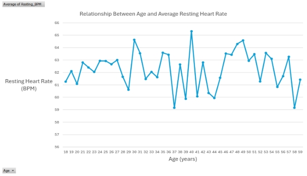
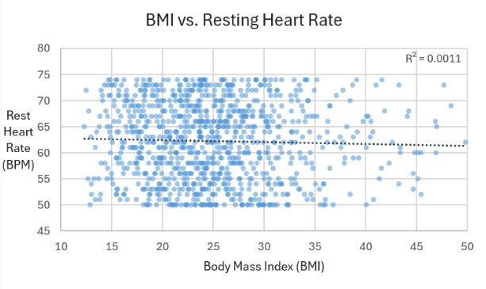
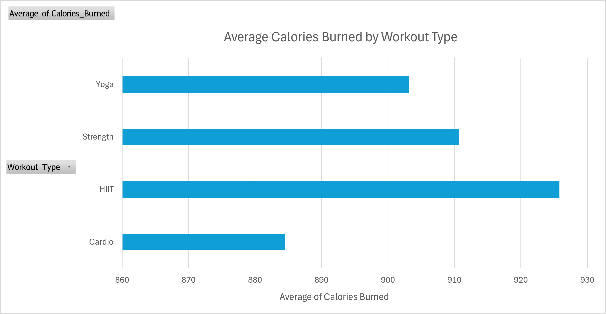
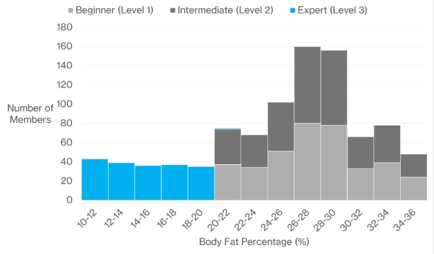

## Group Members

- [Landon Moore](https://landonmo0re.github.io/)
- [Daniel Lain](https://dlain-uark.github.io/)
- [Brady Crebbe](https://bcrebbe.github.io/)
- [Cooper Martindale](https://coopermartindale.github.io/)
- [Garrett Studer](https://gstuder621.github.io/)

## Project Introduction

For this project, our team used Microsoft Excel to study data about gym members and their exercise habits. The dataset included age, resting heart rate, BMI, workout type, calories burned, experience level, and body fat percentage. As a team, we developed four research questions, analyzed the data in Excel, and created assertion-evidence slides to present our findings.

## Question 1: How Does Resting Heart Rate Vary Across Different Age Groups?

**Why we chose this question:** We wanted to see whether resting heart rate changes with age, since age and other factors can affect how the body responds to exercise.

**How we used Excel:** We created a PivotTable with age in the rows and average resting heart rate as the values. We used the PivotTable results to create a line graph showing resting heart rate across ages.

**What we found:** Average resting heart rate fluctuated somewhat between ages 30 and 45, but overall it stayed relatively stable across the sample.

**How the slide was developed:** We added the Excel graph to our assertion-evidence slide and wrote a statement explaining that average resting heart rate was relatively stable across ages.

## Question 2: Is There a Pattern Between BMI and Resting Heart Rate?

**Why we chose this question:** We wanted to test whether people with a higher BMI also tended to have a higher resting heart rate, instead of just assuming that they did.

**How we used Excel:** We made a scatter plot using BMI on the x-axis and resting heart rate on the y-axis. We added a trendline and displayed the R² value. We also adjusted the chart labels, axes, and markers to make the data easier to read.

**What we found:** There was no meaningful relationship between BMI and resting heart rate in our dataset. The trendline was almost flat, with an R² of approximately 0.0011, meaning BMI explained only about 0.11% of the variation in resting heart rate. Resting heart rate stayed around 62 beats per minute across BMI levels.

**How the slide was developed:** We placed the scatter plot on the slide and used the assertion “BMI has no meaningful relationship with resting heart rate.” The chart, trendline, and R² value supported that statement.

## Question 3: Does Workout Type Have a Strong Correlation With Calories Burned?

**Why we chose this question:** We wanted to see whether certain types of workouts burned more calories than others and how large the differences were.

**How we used Excel:** We used a PivotTable to calculate the average calories burned for each workout type. We then made a bar chart to compare those averages.

**What we found:** HIIT had the highest average calories burned at 925.81, followed by strength training at 910.70, yoga at 903.19, and cardio at 884.51. The averages were fairly close, so workout type did not appear to make a large difference in average calories burned in this sample.

**How the slide was developed:** We added the Excel bar chart titled "Average Calories Burned by Workout Type" to our assertion-evidence slide and explained that HIIT had the highest average, but the differences among workout types were relatively small.

## Question 4: How Does Experience Level Differ the Distribution of Body Fat Percentage?

**Why we chose this question:** We wanted to compare the distribution of body fat percentages for people at different workout experience levels.

**How we used Excel:** We counted how many people fell into each 2-percentage-point body fat range, starting at 10%. We separated the counts by beginner, intermediate, and expert experience levels, then used a stacked column chart with no gaps between the bars to make a histogram.

**What we found:** The beginner and intermediate groups had approximately normal-shaped distributions above 20% body fat. The expert group had a more uniform distribution between 10% and 20% body fat.

**How the slide was developed:** We added the histogram from Excel to the slide, kept the formatting consistent with the other slides, and wrote an assertion describing the differences in body fat percentage distributions.

## Conclusion

This project helped us practice using Excel to organize data, compare groups, and create graphs that explain our findings. We also learned how to use assertion-evidence slides to make the main point of a graph clear to an audience.
